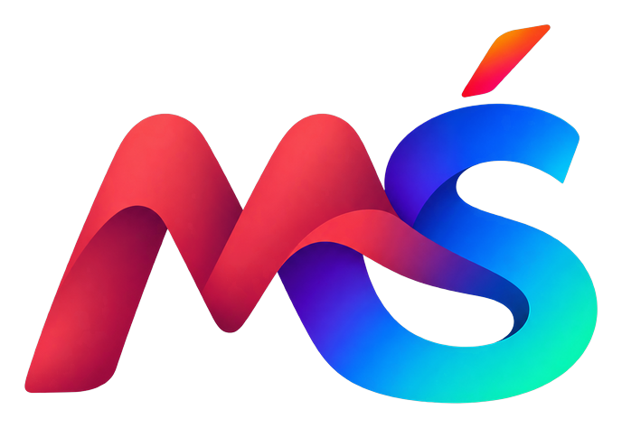

<p align="center">
  
</p>

<h1 align="center">MS Key</h1>

<p align="center">
  <a href="https://www.npmjs.com/package/@minhspark/ms-key"></a>
  <a href="https://www.npmjs.com/package/@minhspark/ms-key"></a>
  <a href="https://www.npmcharts.com/compare/%40minhspark%2Fms-key?minimal=true"></a>
  <br />
  <a href="https://github.com/buidangminh23/ms-key/network/dependents"></a>
  <a href="https://github.com/buidangminh23/ms-key/actions/workflows/ci.yml"></a>
  <a href="https://github.com/buidangminh23/ms-key/releases/latest"></a>
  <a href="LICENSE"></a>
</p>

MS Key is a lightweight, open-source Vietnamese input method for **Windows, Linux and macOS**. One Rust engine does the typing on all three systems, so Telex, VNI and the rest behave the same everywhere. It follows the habits of EVKey, OpenKey, Gõ Nhanh and IBus Bamboo.

## Install

Download the files from the [latest release](https://github.com/buidangminh23/ms-key/releases/latest). Every file is listed with its checksum in `SHA256SUMS`.

With Node.js 18 or newer you can also let npm pick the right file for your system, verify it and run it:

```bash
npx @minhspark/ms-key
```

Add `--download <folder>` to only download and verify the installer.

The installer shows live download progress in interactive terminals and verifies the download before running it. Set `MSKEY_REDUCE_MOTION=1` to use plain progress messages. Redirected output stays free of animation and terminal controls.

### Windows 10/11

Run `MSKey-Setup-<version>-windows-x64.exe`. It installs for your user only and needs no administrator rights. MS Key then sits in the tray as **V** (Vietnamese) or **E** (English).

Windows SmartScreen may warn because the installer is not code-signed: choose **More info > Run anyway**. You can also unzip `MSKey-<version>-windows-x64-portable.zip` (or `MSKey-<version>-windows-arm64-portable.zip` on Windows ARM64) and run `MSKey.exe` without installing. Standalone CLI archives (`mskey-cli-<version>-windows-x64.zip` and `mskey-cli-<version>-windows-arm64.zip`) provide `mskey.exe`.

Package managers (manifests in `packaging/`):

- **WinGet**: `winget install BuiDangMinh.MSKey` (or locally with `winget install --manifest packaging\winget`)
- **Scoop**: `scoop install packaging/scoop/mskey.json` (installs portable `MSKey.exe` and the `mskey.exe` CLI shim)

To remove the installer version, use **Settings > Apps > Installed apps > MS Key > Uninstall**. Your settings in `%APPDATA%\MSKey` are kept.

### Ubuntu / Debian / Arch Linux

```bash
sudo apt install ./mskey_<version>_amd64.deb
ibus restart
```

For ARM64 Debian/Ubuntu systems, use `mskey_<version>_arm64.deb`. Then add **MS Key (Tiếng Việt)** in **Settings > Keyboard > Input Sources** (or `ibus-setup`). Remove it with `sudo apt remove mskey`.

On other distributions with GTK 3 and IBus, extract `MSKey-<version>-linux-amd64.tar.gz` (or `MSKey-<version>-linux-arm64.tar.gz`) and run `./install.sh` (`./uninstall.sh` to remove). Prebuilt binaries require glibc 2.35 or newer.

- **Arch Linux (AUR)**: build from `packaging/aur/PKGBUILD` (`makepkg -si`), which packages `mskey-linux`, the `mskey` CLI, and optionally compiles the Fcitx5 addon when `fcitx5` headers are installed.
- **CLI tarball / Homebrew**: use `mskey-cli-<version>-linux-amd64.tar.gz` (`arm64` also available) or `brew install packaging/homebrew/Formula/mskey-cli.rb`.

### macOS 13+ (Apple Silicon and Intel)

Install from Terminal:

```bash
curl -fsSL https://github.com/buidangminh23/ms-key/releases/latest/download/install-macos.sh | bash
```

The installer downloads the zip, checks it against `SHA256SUMS`, verifies the app signature, installs `MSKey.app` into `/Applications` (or `~/Applications`) and opens it. Use this method: MS Key is ad-hoc signed and not notarized, so macOS blocks copies that a browser downloaded.

You can also install via Homebrew using the manifests in `packaging/`:

```bash
brew install --cask packaging/homebrew/Casks/mskey.rb
brew install packaging/homebrew/Formula/mskey-cli.rb
```

Or download `MSKey-<version>-macos-universal.dmg` from the latest release and open **Install MS Key.app** inside it (or drag **MSKey.app** into **Applications**). A browser marks DMG downloads as downloaded from the internet, so macOS refuses to open unnotarized apps from it until you clear the quarantine attribute once:

```bash
xattr -dr com.apple.quarantine /Applications/MSKey.app
```

On first launch, allow MS Key in **System Settings > Privacy & Security > Accessibility**. After each update, remove the old MS Key entry there and allow it again.

## Quick start

- Press **Ctrl + Shift** to switch between Vietnamese (**V**) and English (**E**). Alt + Z, Ctrl + Space, Shift + Shift or your own shortcut can be chosen instead.
- Open the settings panel from the tray icon (Windows), the IBus menu or app launcher (Linux), or the menu bar icon (macOS).
- The MS logo appears across app icons, settings and installers. Opening settings briefly animates the logo without delaying typing; system reduced-motion settings are respected.

| You type (Telex) | You get | You type (VNI) | You get |
|---|---|---|---|
| `tieesng vieejt` | tiếng việt | `tie61ng vie65t` | tiếng việt |
| `nguwowfi` | người | `ngu7o72i` | người |
| `dduowcj` | được | `d9uo75c` | được |
| `hoaf` | hoà | `hoa2` | hoà |
| `windows` | windows | | |

Press **Esc** right after a word to undo the Vietnamese marks and get back the keys you typed.

## Features

**Typing**

- Telex, VNI, VIQR, Simple Telex and a fully custom keymap.
- Modern (`hoà`, `thuý`) or classic (`hòa`, `thúy`) tone placement, and free tone placement anywhere in the word.
- Spelling check, so invalid Vietnamese syllables are left alone.
- **Smart Code Bypass** (`smart_code_bypass`): automatically keeps camelCase, `snake_case`/`__init__`, alphanumeric identifiers (`sha256`), URLs, email addresses, and file paths unaccented, plus personal dictionary restore support.
- **Hold-to-English & CapsLock Quick Switch**: hold `RightShift`, `LeftShift`, `RightAlt`, `RightCtrl`, or `CapsLock` (`hold_english_key`) to temporarily type English, or enable single-tap CapsLock mode switching (`quick_capslock_switch`).
- **Undo Last Word** (`Ctrl+Shift+Z` by default, alongside `Esc` before delimiters): restores raw keystrokes on the previous committed word.
- **Surrounding-text Re-edit** (`reedit_surrounding_word`): continues editing marks and tones when returning to an existing word before the cursor.
- **Caret HUD** (`show_caret_osd`): compact **V**/**E** overlay near the caret on mode switches. Off by default, like the mode-switch popup (`show_switch_osd`); turn them on in settings.
- Quick typing: `w` → `ư`, `[` → `ơ`, `]` → `ư`, `cc` → `ch`, `nn` → `ng`, `f` → `ph` at the start of a word, and more.
- Optional capitalisation at the start of a sentence.

**Output**

- Unicode (NFC), Unicode composite (NFD), TCVN3 (ABC) and VNI Windows.
- **Selection Converter** (`Ctrl+Shift+F7` by default) to convert highlighted text in-place, plus **Clipboard Converter** (`Ctrl+Shift+F6` by default) for charset conversion, case transforms, and diacritic removal.

**Dynamic Macros**

- Short triggers that expand into longer text (`vn` → `Việt Nam`), configurable to require `Tab` only (`macro_trigger_tab_only`) or trigger on delimiters/punctuation, optionally even while Vietnamese input is off.
- Dynamic tokens: `{cursor}` (`$|`) cursor placement after expansion, `{clipboard}` clipboard insertion, and formatted dates `{date:FORMAT}` alongside `{date}`, `{time}`, `{datetime}`, `{year}`, `{month}`, `{day}`, and `{weekday}`.

**Per-app behaviour & Privacy**

- Remember V or E per application automatically.
- **Window Title Rules**: match per-app rules against `title_pattern` wildcards (`*`) to force Always English, Always Vietnamese, or Ignore.
- **UIA Password detection (Windows)**: queries Windows UI Automation (`IUIAutomation` `IsPassword`) asynchronously so password boxes stay bypassed automatically.
- Fixes for browser address bar suggestions and terminals.

**Settings, Profiles & Sync**

- **Configuration Profiles & Sync**: switch between built-in presets (`Mặc định`, `Lập trình`, `Soạn thảo`) or custom profiles, and sync changes to a shared config path via `sync_config_path`.
- Import an existing EVKey `setting.tree`.
- Light, dark or system theme; start with the system.
- Settings are stored as JSON: `%APPDATA%\MSKey\config.json` on Windows and `~/.config/mskey/config.json` on Linux and macOS.

## Command-line interface (`mskey`)

`crates/mskey-cli` provides the standalone `mskey` CLI tool backed by `mskey-core`:

```bash
mskey convert [--from auto|unicode|tcvn3|vni|nfd|viqr] [--to unicode|tcvn3|vni|nfd|viqr] [--case none|upper|lower|sentence|title|strip|modern-tone|classic-tone] [--in <PATH>] [--out <PATH>]
mskey detect [--in <PATH>] [--json]
mskey check <WORD>... [--in <PATH>] [--allow-fjwz] [--json]
mskey import-evkey <TREE_PATH> [--out <PATH>]
mskey macros export --config <PATH> [--out <PATH>]
mskey macros import --config <PATH> [--file <PATH>] [--replace]
mskey help [COMMAND]
mskey --version
```

## How it works on each system

| | Windows | Linux | macOS |
|---|---|---|---|
| Key capture | `WH_KEYBOARD_LL` keyboard hook | IBus engine over D-Bus (preedit or direct mode, X11 and Wayland) | `CGEventTap` |
| Settings UI | Native Win32 | GTK 3 | SwiftUI + AppKit menu bar app |
| Code | `crates/mskey-win` | `crates/mskey-linux` | `macos/MSKeyMac` via `crates/mskey-ffi` |

All three call the same engine in `crates/mskey-core`, which has no OS dependencies.

## Build from source

You need Rust 1.90 or newer.

**Windows**

```powershell
cargo test --workspace
cargo build --release -p mskey-win -p mskey-cli
```

The GUI app is `target\release\mskey-win.exe` (run with `--show` to open settings immediately) and the CLI is `target\release\mskey.exe`. For Windows ARM64 cross-builds, add `--target aarch64-pc-windows-msvc`.

**Linux** (GTK 3, IBus, and optional Fcitx5 C++ addon)

```bash
sudo apt install libgtk-3-dev pkg-config ibus
cargo test -p mskey-core -p mskey-ffi -p mskey-cli -p mskey-linux
cargo build --release -p mskey-cli
bash scripts/install-linux.sh
```

`install-linux.sh` builds and installs `mskey-linux` into `/usr/local`. Run `ibus restart` afterwards.

To build the optional Fcitx5 C++ addon (`libmskey_ffi` + CMake):

```bash
sudo apt install cmake fcitx5 libfcitx5core-dev
cargo build --release -p mskey-ffi
cmake -B build-fcitx5 -S linux/fcitx5 \
  -DCMAKE_BUILD_TYPE=Release \
  -DCMAKE_INSTALL_PREFIX=/usr \
  -DMSKEY_FFI_LIB_DIR="$PWD/target/release" \
  -DMSKEY_FFI_INCLUDE_DIR="$PWD/crates/mskey-ffi/include"
cmake --build build-fcitx5
sudo cmake --install build-fcitx5
```

**macOS** (Xcode or the Swift 6 toolchain)

```bash
cargo test -p mskey-core -p mskey-ffi -p mskey-cli
bash scripts/build-macos.sh
open dist/MSKey.app
```

## Packaging and releases

Brand assets live in `assets/branding`. `mskey-logo.png` preserves the supplied full logo; `mskey-mark.png` is the transparent symbol used at small sizes. To regenerate ICO, ICNS, PNG sizes and installer bitmaps, install Pillow and run `python scripts/prepare-branding.py`.

| Script / Manifests | Output / Target |
|---|---|
| `scripts/package-windows.ps1` | NSIS installer and portable zip (needs NSIS) |
| `scripts/package-linux.sh` | `.deb` and `.tar.gz` (`amd64` and `arm64`) |
| `scripts/package-macos.sh` | Universal ad-hoc signed `MSKey.app`, animated `Install MS Key.app` DMG, zip, and `install-macos.sh` |
| `packaging/winget/` | WinGet multi-file manifests (`BuiDangMinh.MSKey`) |
| `packaging/scoop/mskey.json` | Scoop manifest (`x64`/`arm64` portable app + `mskey.exe` CLI shim) |
| `packaging/homebrew/` | Homebrew Cask (`Casks/mskey.rb`) and CLI Formula (`Formula/mskey-cli.rb`) |
| `packaging/aur/` | Arch Linux `PKGBUILD` and `.SRCINFO` (`mskey-linux`, `mskey`, optional Fcitx5 addon) |

Pushing a tag such as `v0.1.3` runs `.github/workflows/release.yml`. It builds desktop packages and `mskey-cli` archives across Windows (`x64` and cross-compiled `arm64`), Linux (`amd64` and `arm64`), and macOS (universal), runs smoke checks, and publishes the release with `SHA256SUMS` and the matching section of [CHANGELOG.md](CHANGELOG.md). The tag must match the version in `Cargo.toml`.

The DMG installer animates the MS Key logo while copying, reports bytes copied, verifies the app signature and restores the previous app if the final replacement fails. It supports cancellation and Reduce Motion. Finder drag-to-Applications remains available. The Terminal installer adds live download progress and activity indicators during unpacking, signature verification and copying.

## Repository layout

```text
crates/
  mskey-core/     Typing engine, charset converter, dictionaries, EVKey importer
  mskey-ffi/      C ABI used by macOS and Fcitx5 (mskey_core.h)
  mskey-win/      Windows hook, UIA password detection, tray icon, settings UI
  mskey-linux/    IBus engine and GTK settings UI
  mskey-cli/      Standalone mskey command-line interface
macos/
  MSKeyMac/       Swift menu bar app
  MSKeyInstaller/ SwiftUI DMG installer app
linux/fcitx5/     Optional Fcitx5 C++ addon
packaging/        WinGet, Scoop, Homebrew, and AUR distribution manifests
data/             IBus component and desktop entry
scripts/          Build, install and packaging scripts
```

## Contributing

Bug reports and pull requests are welcome in [Issues](https://github.com/buidangminh23/ms-key/issues). Please run `cargo test --workspace` and `cargo clippy --workspace --all-targets -- -D warnings` before opening a pull request.

## License

MS Key is released under the [MIT License](LICENSE).

The Vietnamese and English word lists in `crates/mskey-core/data` come from [Gõ Nhanh](https://github.com/khaphanspace/gonhanh.org) under the BSD 3-Clause License; see [THIRD-PARTY-NOTICES.md](THIRD-PARTY-NOTICES.md).
